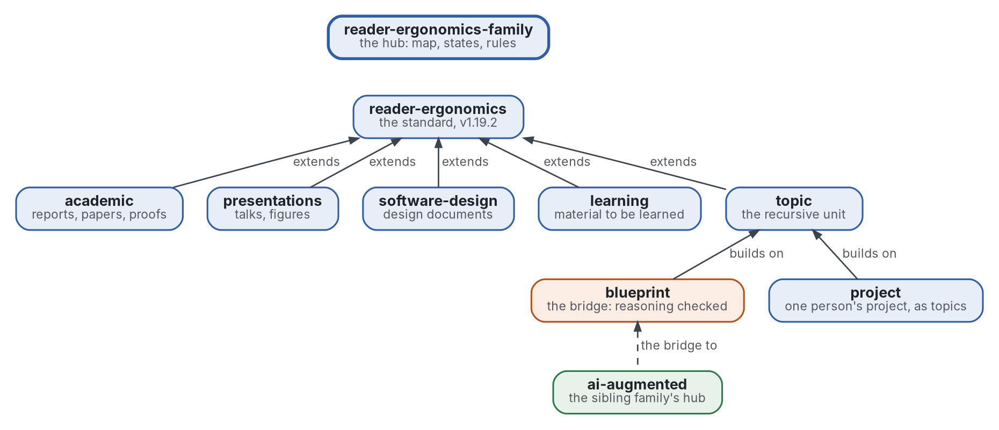

# Famille reader-ergonomics

[](https://github.com/Tewf/reader-ergonomics-family/actions/workflows/checks.yml)
[](https://tewf.github.io/reader-ergonomics-family/)

La page d'accueil de la **famille reader-ergonomics** : la norme, les extensions qui l'appliquent à un genre chacune,
le topic sur lequel elles s'appuient, et les deux qui en sortent. Cette page tient la carte, l'état de chaque membre et
les règles que les membres partagent ; elle ne tient rien qu'un membre possède. La norme elle-même liste ses extensions
et ne dépend d'aucune, donc la carte qui pointe dans les deux sens vit ici.

Cette page en anglais : [README.md](README.md). Les deux versions suivent le même état.

> **État (2026-11-02) :** la carte, l'état des membres, les six règles écrites, et deux programmes : un audit
> hebdomadaire de chaque membre et une vérification que les états ci-dessous suivent les étiquettes de GitHub. Ce n'est ni une norme officielle, ni une étude relue par des pairs, ni un résultat nouveau.
>
> **Comment il est fait :** avec Claude, un assistant IA d'Anthropic, sous la direction du mainteneur, comme
> reader-ergonomics. Les corrections sont bienvenues sous forme d'issues.

## La carte


<details>
<summary>Graphviz source</summary>



</details>

| Membre | Problème | État |
|---|---|---|
| [reader-ergonomics](https://github.com/Tewf/reader-ergonomics) | la norme : des principes gradés par leur preuve, des formes à remplir, des vérifications à lancer sur tout texte | v1.19.2, déclarée finie |
| [reader-ergonomics-academic](https://github.com/Tewf/reader-ergonomics-academic) | rapports, articles de recherche, articles mathématiques et preuves | v1.0.0 |
| [reader-ergonomics-presentations](https://github.com/Tewf/reader-ergonomics-presentations) | exposés, et la figure ou le diagramme dans tout document | v1.0.0 |
| [reader-ergonomics-software-design](https://github.com/Tewf/reader-ergonomics-software-design) | les documents qui conçoivent un logiciel avant le code | v1.0.0 |
| [reader-ergonomics-learning](https://github.com/Tewf/reader-ergonomics-learning) | le matériel fait pour être appris | v1.0.0 |
| [reader-ergonomics-topic](https://github.com/Tewf/reader-ergonomics-topic) | une unité d'écriture récursive, le topic, et sa vérification | v0.6.1 |
| [reader-ergonomics-blueprint](https://github.com/Tewf/reader-ergonomics-blueprint) | le raisonnement en arbre de topics, un vérificateur par partie, Lean d'abord, un modèle qui oriente | B1 en miniature construit : le théorème d'Euclide en topics, Lean vert en CI |
| [reader-ergonomics-project](https://github.com/Tewf/reader-ergonomics-project) | comment une personne mène un projet, chaque étape un topic | revue faite (38 sources) ; la forme du projet et sa vérification |

Les deux derniers membres sortent de cette famille. Le blueprint est le pont vers la
[famille AI-augmented](https://github.com/Tewf/ai-augmented), où une personne, un modèle et une machine partagent un
projet. Le projet y a son pendant, [ai-augmented-project](https://github.com/Tewf/ai-augmented-project).

## Les règles

- **La norme ne dépend d'aucune extension.** Une extension lie les principes et les formes de la norme à une version,
  épinglée par commit dans chaque workflow, et ne les copie jamais. La norme peut lister une extension, jamais la lire
  ([extending.md](https://github.com/Tewf/reader-ergonomics/blob/b9732b9814c71768f722691f3c5049ec2b8ed378/extending.md)).
- **Un genre par extension**, et seulement ce que le genre change : un principe que la norme tient déjà est lié.
- **Chaque membre exécute les vérifications de la norme en CI**, et les siennes dans `checks/local/`. Une
  vérification écrite par une extension est proposée à la norme une fois qu'elle tient sur la famille. Chaque
  membre l'exécute alors dès sa prochaine montée d'épingle.
- **Chaque propriétaire de genre audite toute la famille** dans son genre ; un constat va au dépôt propriétaire comme
  issue, jamais comme push.
- **Une montée d'épingle est une ligne de changelog**, pas une fiche de décision, et elle déplace tous les workflows à la fois.
- **Chaque membre a une version qu'un lecteur peut copier**, avec un bloc « prenez-la » sur sa page d'accueil.

## Le premier travail

Fait le 2026-11-02, en première passe : les règles en [pages](rules/), l'audit en [programme](checks/local/family_audit.py)
lancé chaque semaine par [family-audit.yml](.github/workflows/family-audit.yml), et [la vérification de la carte](checks/local/map_true.py).

1. **Les règles, écrites.** Les six règles ci-dessus sont tenues dans les notes du mainteneur et dans l'`extending.md`
   de la norme. Ici elles reçoivent [une page chacune](rules/), avec leur raison et leur histoire, liée depuis les membres.
2. **L'audit de la famille comme programme.** Le 2026-10-29, chaque propriétaire de genre a audité la famille à la
   main et avec un script par genre. Le travail est un programme qui lance les vérifications de chaque membre sur
   chaque membre et rapporte, pour que l'audit soit répété par la CI plutôt que retenu de mémoire.
3. **La carte tenue à jour par une vérification :** l'épingle, la version et l'état de chaque membre sur cette page
   comparés à ce que GitHub tient, pour que la page ne vieillisse pas en silence.

## Vérifier

L'audit de la famille et la vérification de la carte tournent chaque semaine. À la main, depuis ce dépôt :

```sh
python3 -m unittest discover -s checks/local
python3 checks/local/family_audit.py --standard chemin/vers/reader-ergonomics
python3 chemin/vers/reader-ergonomics/checks/run.py . --online --only map-true
```

Pour vérifier ce dépôt lui-même :

```sh
git clone https://github.com/Tewf/reader-ergonomics
python3 reader-ergonomics/checks/run.py chemin/vers/ce/depot
```

La CI exécute les mêmes vérifications à chaque push, et une exécution échoue à la première erreur
([checks.yml](https://github.com/Tewf/reader-ergonomics-family/blob/master/.github/workflows/checks.yml)). Chaque push
sur master construit aussi le site, [tewf.github.io/reader-ergonomics-family](https://tewf.github.io/reader-ergonomics-family/)
([pages.yml](https://github.com/Tewf/reader-ergonomics-family/blob/master/.github/workflows/pages.yml)).

## Contenu

| Partie | Résumé |
|---|---|
| [rules](rules/) | les six règles communes, une page chacune avec sa raison et son histoire |
| [checks/local](checks/local/) | l'audit de la famille et la vérification de la carte, avec leurs tests |
| [decisions](decisions/) | une fiche par choix qui façonne ce dépôt, chacune ouvrant sur la décision en une phrase |

## Licence

Code sous [Apache License 2.0](LICENSE) ; prose sous [CC BY 4.0](LICENSES/CC-BY-4.0.txt). Réutilisez-le comme vous le
souhaitez, en créditant ce dépôt ; [CITATION.cff](CITATION.cff) donne une citation si besoin.
