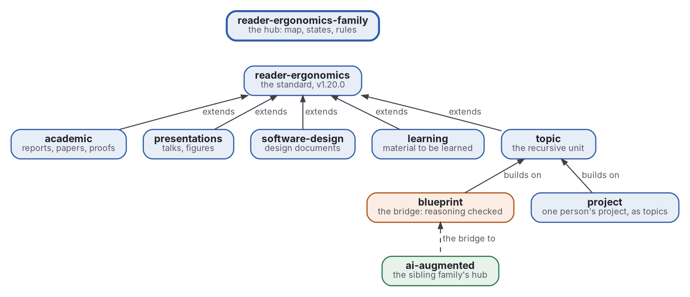

# reader-ergonomics family

[](https://github.com/Tewf/reader-ergonomics-family/actions/workflows/checks.yml)
[](https://tewf.github.io/reader-ergonomics-family/)

The front page of the **reader-ergonomics family**: the standard, the extensions that apply it to one genre each, the
topic they build on, and the two that lead out of it. This page holds the map, each member's state, and the rules the
members share; it holds nothing a member owns. The standard itself lists its extensions and depends on none of them,
so the map that points both ways lives here.

This page in French: [README.fr.md](README.fr.md).

> **Status (2026-11-03):** version 0.1.0: the map, the members' states, the six rules written out, and two programs: a weekly audit of
> every member and a check that the states below match GitHub's tags. It is not an official
> standard, not a peer-reviewed study and not a new result.
>
> **How it is made:** with Claude, an AI assistant by Anthropic, under the maintainer's direction, the way
> reader-ergonomics was made. Corrections are welcome as issues.

## Take it

The page is meant to be copied for a family of your own. Copy it from a tagged release
([tags](https://github.com/Tewf/reader-ergonomics-family/tags)), so a later change here never changes your copy.

1. Copy [README.md](README.md) as your map, the [rules/](rules/) you keep, and [checks/local/](checks/local/), the two
   checks and their tests, into the same paths of your repository.
2. Replace the member table and the map with your members; keep one State column that names each member's newest tag.
3. Add `checks/config.toml` with `extends = "reader-ergonomics"`, as [this one](checks/config.toml) does, and list your
   members under `[family_audit]` and `[bibliography_keys]`.
4. Pin the standard by commit in every workflow, as [checks.yml](.github/workflows/checks.yml) does, and run it:

   ```sh
   git clone https://github.com/Tewf/reader-ergonomics
   git -C reader-ergonomics checkout 4f99372093729dacf982e9174e94f6b8793c513d
   python3 reader-ergonomics/checks/run.py path/to/your/repository
   ```

5. How to take your own version, and where a disagreement goes: the standard's
   [Take your own version](https://github.com/Tewf/reader-ergonomics/blob/4f99372093729dacf982e9174e94f6b8793c513d/README.md#take-your-own-version).

## The map


<details>
<summary>Graphviz source</summary>



</details>

| Member | Problem | State |
|---|---|---|
| [reader-ergonomics](https://github.com/Tewf/reader-ergonomics) | the standard: principles graded by their evidence, shapes to fill, checks to run on any text | v1.20.0, declared done |
| [reader-ergonomics-academic](https://github.com/Tewf/reader-ergonomics-academic) | reports, research papers, mathematical articles and proofs | v1.0.0 |
| [reader-ergonomics-presentations](https://github.com/Tewf/reader-ergonomics-presentations) | talks, and the figure or diagram in any document | v1.0.0 |
| [reader-ergonomics-software-design](https://github.com/Tewf/reader-ergonomics-software-design) | the documents that design software before the code | v1.0.0 |
| [reader-ergonomics-learning](https://github.com/Tewf/reader-ergonomics-learning) | material meant to be learned | v1.0.0 |
| [reader-ergonomics-topic](https://github.com/Tewf/reader-ergonomics-topic) | one recursive unit of writing, the topic, and its check | v0.6.1 |
| [reader-ergonomics-blueprint](https://github.com/Tewf/reader-ergonomics-blueprint) | reasoning as a tree of topics, a checker per part, Lean first, a model that guides | B1 in miniature built: Euclid's theorem as topics, Lean green in CI |
| [reader-ergonomics-project](https://github.com/Tewf/reader-ergonomics-project) | how one person runs a project, each step a topic | review done (38 sources); the project shape and its check |

The two last members lead out of this family. The blueprint is the bridge to the
[AI-augmented family](https://github.com/Tewf/ai-augmented), where a person, a model and a machine share one project.
The project has its counterpart there, [ai-augmented-project](https://github.com/Tewf/ai-augmented-project).

## The rules

- **The standard depends on no extension.** An extension links the standard's principles and shapes at one release,
  pinned by commit in every workflow, and never copies them. The standard may list an extension, never read it
  ([extending.md](https://github.com/Tewf/reader-ergonomics/blob/4f99372093729dacf982e9174e94f6b8793c513d/extending.md)).
- **One genre per extension**, and only what the genre changes: a principle the standard already holds is linked.
- **Every member runs the standard's checks in CI**, and its own in `checks/local/`. A check an extension writes is
  proposed to the standard once it holds on the family. Every member then runs it from its next pin raise.
- **Each genre owner audits the whole family** in its genre; a finding goes to the owning repository as an issue,
  never as a push.
- **A pin raise is a changelog line**, not a decision record, and it moves every workflow at once.
- **Every member has a release a reader can copy from**, with a take-it block on its front page.

## The first job

Done on 2026-11-02, as a first pass: the rules as [pages](rules/), the audit as [a program](checks/local/family_audit.py)
run weekly by [family-audit.yml](.github/workflows/family-audit.yml), and [the map check](checks/local/map_true.py).

1. **The rules, written down.** The six rules above are held in the maintainer's notes and in the standard's
   `extending.md`; here they get [one page each](rules/) with their reason and their history, linked from the members.
2. **The family audit as a program.** On 2026-10-29 each genre owner audited the family by hand and with one script
   per genre. The job is one program that runs every member's checks on every member and reports, so the audit is
   repeated by CI rather than remembered.
3. **The map kept true by a check:** every member's pin, release and state on this page compared with what GitHub
   holds, so the page cannot go stale in silence.

## Check it

The family audit and the map check run weekly. By hand, from a checkout of this repository:

```sh
python3 -m unittest discover -s checks/local
python3 checks/local/family_audit.py --standard path/to/reader-ergonomics
python3 path/to/reader-ergonomics/checks/run.py . --online --only map-true
```

To check this repository itself:

```sh
git clone https://github.com/Tewf/reader-ergonomics
python3 reader-ergonomics/checks/run.py path/to/this/repository
```

CI runs the same checks on every push, and a run fails on any error
([checks.yml](https://github.com/Tewf/reader-ergonomics-family/blob/master/.github/workflows/checks.yml)). Every push
to master also renders the site, [tewf.github.io/reader-ergonomics-family](https://tewf.github.io/reader-ergonomics-family/)
([pages.yml](https://github.com/Tewf/reader-ergonomics-family/blob/master/.github/workflows/pages.yml)).

## Contents

| Part | Summary |
|---|---|
| [rules](rules/) | the six shared rules, one page each with its reason and its history |
| [checks/local](checks/local/) | the family audit and the map check, with their unit tests |
| [decisions](decisions/) | one record per choice that shapes this repository, each opening with the decision in one sentence |

## Licence

Code under the [Apache License 2.0](LICENSE); prose under [CC BY 4.0](LICENSES/CC-BY-4.0.txt). Reuse it as you wish,
with credit to this repository; [CITATION.cff](CITATION.cff) gives a citation if you need one.
